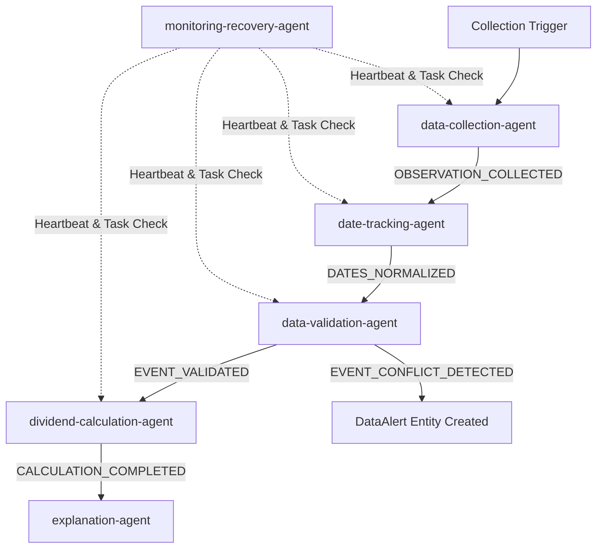

# DividendLens — Agent Architecture Contract

**Document Version:** 1.0  
**Status:** Frozen Swarm Architecture & Message Specification  
**Target System:** Python Async Workers + Redis RQ Queue Pipeline  

---

## 1. Purpose of the Swarm Architecture

The DividendLens swarm architecture organizes corporate action data collection, date parsing, data validation, portfolio calculations, and user explanations into a set of small, decoupled, single-responsibility software processes ("agents").

Rather than relying on a single monolith or an opaque LLM prompt, the swarm architecture:
- Segregates data ingestion, rule validation, and monetary calculations.
- Surfaces data quality issues (stale observations, missing fields, source conflicts) explicitly.
- Enables fault isolation: if one worker process crashes or loses network connectivity, the system detects the failure, updates worker health state, and safely retries or reassigns idempotent tasks without corrupting portfolio state.
- Provides demonstrable system observability for hackathon evaluation.

---

## 2. Core Architectural Principles

1. **Deterministic Financial Facts:** Financial calculations ($\text{Eligible Shares} \times \text{DPS}$) and field validation rules are 100% deterministic code.
2. **AI Boundary Rule:** AI/LLM components (Explanation Agent) consume validated facts to produce beginner-friendly text explanations. **AI MUST NOT** create, modify, or infer dividend values, ex-dates, share quantities, or monetary calculations.
3. **Idempotency by Design:** All tasks carry a unique `task_id` and `correlation_id`. Re-running an agent task multiple times produces identical state without duplicate records or payments.
4. **No Silent Merging or Consensus Voting:** When sources conflict (e.g. BSE reports ₹10 DPS while NSE reports ₹12 DPS), agents flag a `conflict` alert and preserve both raw observations with provenance timestamps. Agents NEVER perform blind majority voting.
5. **Practical Hackathon Infrastructure:** Implemented using lightweight Python modules executing as Redis RQ worker processes exchanging versioned JSON messages. No Kafka, Kubernetes, Paxos/Raft, or complex multi-agent frameworks required.

---

## 3. Core Agent Specifications

### 3.1 Data Collection Agent

* **Agent Name:** `data-collection-agent`
* **Purpose:** Fetch raw dividend event disclosures from seeded demo fixtures or configured external provider adapters.
* **Inputs:** Data collection task (`task_id`, `company_ticker`, `source_name`).
* **Outputs:** Raw source observation payload containing observed DPS, currency, raw date strings, and source URL.
* **Responsibilities:**
  1. Poll or read target corporate action disclosures for requested tickers.
  2. Capture raw source metadata (`observed_at`, `source_url`, `source_name`).
  3. Emit `observation_collected` event message.
* **Does it modify financial facts?:** No. It records raw observations without altering or validating values.
* **Failure Behavior:** Bounded retry (max 3 attempts). If source unavailable, emit `collection_failed` message and mark task failed.
* **Dependencies:** Seeded demo JSON fixtures / HTTP provider adapters.
* **Messages Consumed:** `COLLECTION_TASK_DISPATCHED`
* **Messages Produced:** `OBSERVATION_COLLECTED`, `COLLECTION_FAILED`

---

### 3.2 Date Tracking Agent

* **Agent Name:** `date-tracking-agent`
* **Purpose:** Parse, normalize, and validate calendar dates (announcement date, ex-date, record date, payment date).
* **Inputs:** Raw observation message from `data-collection-agent`.
* **Outputs:** Normalized ISO-8601 date payload (`YYYY-MM-DD`) and missing date flags.
* **Responsibilities:**
  1. Parse date strings into strict `YYYY-MM-DD` calendar format.
  2. Flag missing dates as `null` (never fabricate missing dates).
  3. Validate logical sequence (e.g., `announcement_date <= ex_date <= record_date <= payment_date`).
  4. Emit `dates_normalized` message.
* **Does it modify financial facts?:** No. Normalizes date representations without altering financial values.
* **Failure Behavior:** If date string is unparseable, set date field to `null` and set `has_date_error = true`.
* **Dependencies:** `data-collection-agent` output.
* **Messages Consumed:** `OBSERVATION_COLLECTED`
* **Messages Produced:** `DATES_NORMALIZED`, `DATE_PARSING_FAILED`

---

### 3.3 Data Validation Agent

* **Agent Name:** `data-validation-agent`
* **Purpose:** Validate observations against existing records to detect duplicates, missing fields, stale data, and material conflicts.
* **Inputs:** `dates_normalized` message + existing database records for the company.
* **Outputs:** Validation report containing `validation_status` (`valid`, `conflict`, `stale`, `incomplete`, `failed`) and alert entities if issues exist.
* **Responsibilities:**
  1. Check duplicate status using composite keys (`company_id` + `event_type` + `ex_date`).
  2. Compare new observation fields against existing stored observations from other sources.
  3. Detect material conflicts (e.g., DPS mismatch $> \text{₹0.00}$).
  4. Detect stale data (last validated $> 7\text{ days}$ ago).
  5. Create `DataAlert` entities in database when conflicts or stale data occur.
  6. Emit `event_validated` or `event_conflict_detected` message.
* **Does it modify financial facts?:** No. Assigns validation status tags and flags alerts. Does not overwrite stored raw observations.
* **Failure Behavior:** Mark event `validation_status = 'failed'` and emit alert.
* **Dependencies:** Database access (ORM), `date-tracking-agent` output.
* **Messages Consumed:** `DATES_NORMALIZED`
* **Messages Produced:** `EVENT_VALIDATED`, `EVENT_CONFLICT_DETECTED`, `VALIDATION_FAILED`

---

### 3.4 Dividend Calculation Agent

* **Agent Name:** `dividend-calculation-agent`
* **Purpose:** Deterministically calculate gross dividend estimates for user holdings based on validated event data.
* **Inputs:** `event_validated` message + active user `Holding` records.
* **Outputs:** Calculated dividend estimate record (`eligible_shares`, `dividend_per_share`, `estimated_gross_amount`, `calculation_status`).
* **Responsibilities:**
  1. Query active user holdings matching the event's `company_id`.
  2. Evaluate share eligibility rule: check if `holding.purchase_date < event.ex_date`.
  3. Execute deterministic formula: $\text{Gross Amount} = \text{Eligible Shares} \times \text{DPS}$ using `Decimal` arithmetic.
  4. Assign status: `calculated` (if fully verified), `provisional` (if optional purchase date missing or unverified), or `unavailable` (if event is in `conflict`).
  5. Emit `calculation_completed` message.
* **Does it modify financial facts?:** Yes. Generates calculated income estimates (`estimated_gross_amount`) stored in the database.
* **Failure Behavior:** If calculation fails (e.g. missing DPS), mark result `unavailable` and emit `calculation_failed`.
* **Dependencies:** `data-validation-agent` output, User `Holding` database records.
* **Messages Consumed:** `EVENT_VALIDATED`
* **Messages Produced:** `CALCULATION_COMPLETED`, `CALCULATION_FAILED`

---

### 3.5 Explanation Agent (P1)

* **Agent Name:** `explanation-agent`
* **Purpose:** Transform structured calculation results and validation reports into beginner-friendly plain-language text.
* **Inputs:** `calculation_completed` or `event_conflict_detected` message + domain context facts.
* **Outputs:** Plain-language explanation string, formula representation, and provider identifier (`template` or `openai`).
* **Responsibilities:**
  1. Construct plain-language template text using deterministic inputs ($\text{Shares}$, $\text{DPS}$, $\text{Dates}$, $\text{Source Name}$).
  2. If optional LLM mode is enabled (`OPENAI_API_KEY`), call `OpenAIExplanationProvider` with strictly bounded context prompt.
  3. Fall back to `TemplateExplanationProvider` if API call fails or is disabled.
  4. Emit `explanation_generated` message.
* **Does it modify financial facts?:** No. Strictly textual formatting.
* **Failure Behavior:** Fall back immediately to template-based text if LLM call fails.
* **Dependencies:** `dividend-calculation-agent` output, optional OpenAI API adapter.
* **Messages Consumed:** `CALCULATION_COMPLETED`, `EVENT_CONFLICT_DETECTED`
* **Messages Produced:** `EXPLANATION_GENERATED`

---

### 3.6 Monitoring & Recovery Agent (P1)

* **Agent Name:** `monitoring-recovery-agent`
* **Purpose:** Monitor worker heartbeat status, detect stalled/failed tasks, manage retries, and update system health badges.
* **Inputs:** Agent heartbeat pulses from Redis (`agent_heartbeat` keys) and task event logs.
* **Outputs:** Agent health summary (`online`, `degraded`, `offline`), task retry dispatches, and system alerts.
* **Responsibilities:**
  1. Check worker heartbeat timestamps every $5\text{ seconds}$.
  2. Mark an agent `offline` if heartbeat missed for $>15\text{ seconds}$.
  3. Re-queue idempotent tasks assigned to offline agents.
  4. Track retry attempt limits (max 3 retries).
  5. Update system health badge status (`healthy`, `degraded`, `unhealthy`).
* **Does it modify financial facts?:** No. Operational monitoring and queue orchestration only.
* **Failure Behavior:** Logs system alert if Redis monitoring loop itself encounters an error.
* **Dependencies:** Redis key-value store, Task Queue registry.
* **Messages Consumed:** `HEARTBEAT_PULSE`, `TASK_FAILED`
* **Messages Produced:** `AGENT_STATUS_CHANGED`, `TASK_RETRY_DISPATCHED`, `SYSTEM_HEALTH_UPDATED`

---

## 4. Message Contract & Task Schema

### 4.1 Message Schema (JSON)

Every inter-agent message MUST conform to the following JSON structure:

```json
{
  "message_id": "msg-8f9a0b1c-2d3e-4f5a-6b7c-8d9e0f1a2b3c",
  "task_id": "task-val-tcs-001",
  "correlation_id": "corr-wf-20260926-001",
  "sender": "data-validation-agent",
  "recipient": "dividend-calculation-agent",
  "message_type": "EVENT_VALIDATED",
  "schema_version": "1.0",
  "timestamp": "2026-09-26T15:30:00Z",
  "payload": {
    "event_id": "f6a7b890-1234-5678-f012-678901234567",
    "company_ticker": "TCS",
    "dividend_per_share": "10.00",
    "currency": "INR",
    "ex_date": "2026-10-10",
    "validation_status": "valid",
    "source_name": "BSE Disclosure",
    "is_demo_data": true
  }
}
```

### 4.2 Field Definitions
* `message_id`: Unique identifier for the specific message instance (UUID v4 string).
* `task_id`: Unique task identifier used for idempotency tracking (string).
* `correlation_id`: Identifier grouping all messages belonging to a single workflow execution (string).
* `sender`: Identifier of the emitting agent (`string`).
* `recipient`: Target topic or agent identifier (`string` or `"broadcast"`).
* `message_type`: Enum string representing event type (e.g. `EVENT_VALIDATED`, `EVENT_CONFLICT_DETECTED`).
* `schema_version`: Version string (`"1.0"`).
* `timestamp`: ISO-8601 UTC timestamp (`YYYY-MM-DDTHH:mm:ssZ`).
* `payload`: Structured JSON object containing task-specific business data.

---

## 5. Workflows & State Machine Transitions

### 5.1 Validation Workflow State Transitions

```
[Raw Observation]
       │
       ▼
(Date Tracking Agent) ──► Normalizes Dates
       │
       ▼
(Data Validation Agent)
       ├───────────────────────────────┐
       ▼ (Valid / Match)               ▼ (Material Discrepancy)
[Validation Status: VALID]     [Validation Status: CONFLICT]
       │                               │
       ▼                               ▼
(Calculation Agent)            (DataAlert Created)
       │                               │
       ▼                               ▼
[Calculated Gross Income]      [Calculation Status: UNAVAILABLE]
                                       │
                                       ▼ (Human Review)
                               [User/Admin Resolution]
                                       │
                                       ▼
                               [Validation Status: VALID]
```

---

## 6. End-to-End Execution Scenarios

### A. Agent Dependency Flow



---

### B. Example Message Flow Trace (Happy Path)

1. **Trigger:** API receives workflow trigger for company `TCS`.
2. **Message 1 (`COLLECTION_TASK_DISPATCHED`):**
   * Sender: `api-supervisor` -> Recipient: `data-collection-agent`
   * Correlation ID: `corr-tcs-101`
3. **Message 2 (`OBSERVATION_COLLECTED`):**
   * Sender: `data-collection-agent` -> Recipient: `date-tracking-agent`
   * Payload: Raw DPS `"10.00"`, Raw ex-date `"10/10/2026"`, Source `"BSE Disclosure"`.
4. **Message 3 (`DATES_NORMALIZED`):**
   * Sender: `date-tracking-agent` -> Recipient: `data-validation-agent`
   * Payload: Ex-date `"2026-10-10"`, Record-date `"2026-10-11"`, Payment-date `"2026-10-25"`.
5. **Message 4 (`EVENT_VALIDATED`):**
   * Sender: `data-validation-agent` -> Recipient: `dividend-calculation-agent`
   * Payload: Validation Status `"valid"`, DPS `"10.00"`.
6. **Message 5 (`CALCULATION_COMPLETED`):**
   * Sender: `dividend-calculation-agent` -> Recipient: `explanation-agent`
   * Payload: Eligible Shares `25`, Estimated Gross `"250.00"`, Status `"calculated"`.
7. **Message 6 (`EXPLANATION_GENERATED`):**
   * Sender: `explanation-agent` -> Recipient: `api-database-sink`
   * Payload: Explanation `"Your 25 shares of TCS yield an estimated dividend of ₹250.00."`

---

### C. Failure & Recovery Scenario (Agent Offline)

1. **Trigger:** `data-collection-agent` process is manually terminated during demo.
2. **Detection:** `monitoring-recovery-agent` checks Redis key `heartbeat:data-collection-agent-1`.
3. **Timeout:** Key missing for $>15\text{ seconds}$. Agent status set to `"offline"`.
4. **Task Reassignment:** Monitoring agent queries Redis task queue for unacknowledged task `task-col-tcs-002`.
5. **Recovery Dispatch:** Task is re-queued to secondary worker `data-collection-agent-2` with `attempt = 2`.
6. **Execution:** Secondary worker processes task, emits `OBSERVATION_COLLECTED` message.
7. **Result:** Dashboard Agent Monitor displays Agent 1 as `"offline"`, Agent 2 as `"online"`, and marks task execution `"recovered"`. Zero duplicate records created in PostgreSQL.

---

### D. Conflict Scenario (BSE vs. NSE Discrepancy)

1. **Observation 1 Ingested:** BSE reports TCS DPS = `"10.00"`, Ex-date `"2026-10-10"`.
2. **Observation 2 Ingested:** NSE reports TCS DPS = `"12.00"`, Ex-date `"2026-10-10"`.
3. **Validation Check:** `data-validation-agent` compares both observations for same `company_id` and `ex_date`.
4. **Conflict Detected:** DPS mismatch ($\text{₹10.00} \neq \text{₹12.00}$).
5. **State Update:**
   * `DividendEvent.validation_status` set to `'conflict'`.
   * `DataAlert` created with `alert_type = 'conflict'`.
   * `DividendCalculationAgent` marks income calculation `status = 'unavailable'`.
6. **UI Alert:** Dashboard displays amber Data Quality Banner ("1 Source Conflict Detected").
7. **Human Resolution:** Admin reviews side-by-side sources on Alerts page and selects BSE (`"10.00"`).
8. **Resolution Execution:** `POST /api/v1/alerts/{id}/resolve` marks BSE authoritative, clears alert, updates event `validation_status = 'valid'`, and triggers `DividendCalculationAgent` to compute gross income (`₹250.00`).

---

### E. Hackathon 5-Minute Presentation Scenario

* **Minute 1: Introduction & Portfolio Setup**
  * Presenter logs into DividendLens, creates "Core Equities" portfolio, and adds 25 shares of TCS.
  * Dashboard displays Expected Dividend Income ($\text{₹250.00}$) calculated by the agent swarm.
* **Minute 2: Swarm Activity Inspection**
  * Presenter navigates to Agent Monitor page.
  * Shows live status of all 4 active agents (`Data Collection`, `Date Tracking`, `Data Validation`, `Calculation`) exchanging correlated messages.
* **Minute 3: Source Conflict Demonstration**
  * Presenter clicks "Simulate Data Conflict" demo button.
  * System ingests conflicting NSE report ($\text{₹12.00}$ vs $\text{₹10.00}$).
  * Validation Agent immediately flags a Conflict Alert. Estimate switches to `"Unavailable / Needs Review"`. Presenter highlights that the system NEVER silently guesses or averages financial data.
  * Presenter clicks "Resolve Alert", selects BSE disclosure, and calculation returns to $\text{₹250.00}$.
* **Minute 4: Agent Failure & Self-Healing Demo**
  * Presenter clicks "Stop Data Collection Agent" demo control.
  * Agent Monitor turns red for Data Collection Agent within 15s.
  * Presenter triggers a refresh: Monitoring Agent detects offline worker, reassigns task to standby process, and completes the workflow cleanly.
* **Minute 5: Summary & Key Takeaways**
  * Presenter emphasizes: Deterministic financial accuracy, plain-language explanations, complete provenance, and visible multi-agent resilience.
